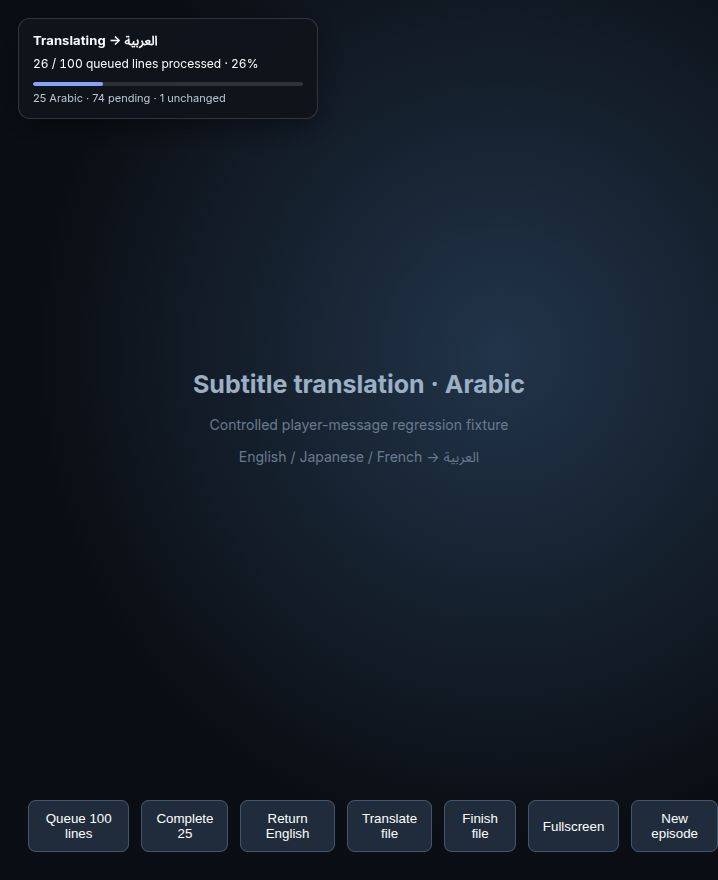
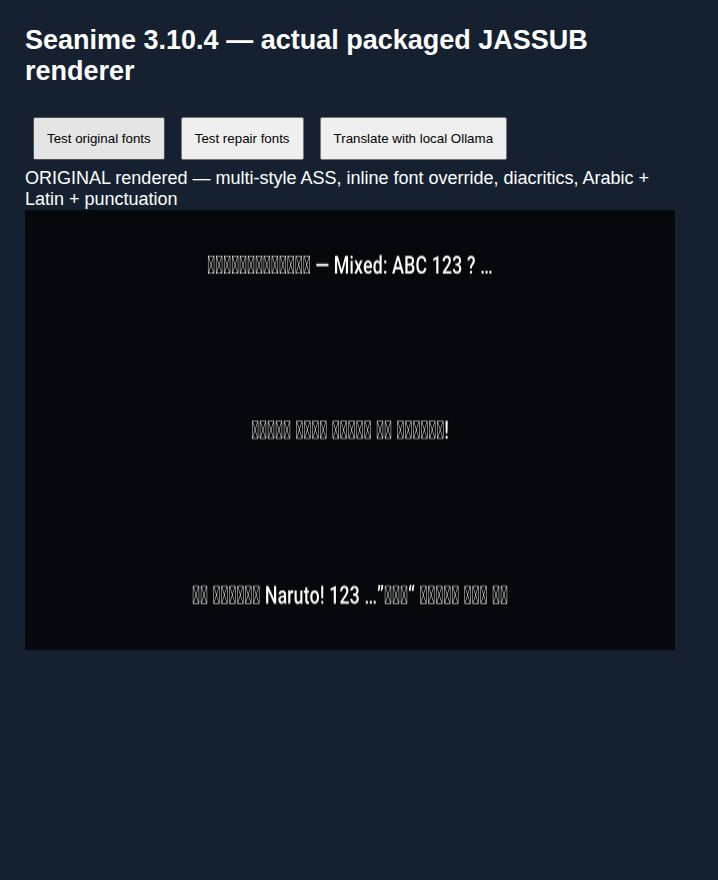
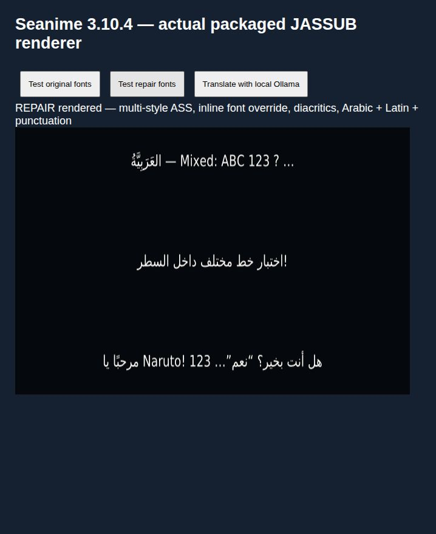

# Arabic subtitle font repair for Seanime 3.10.4

This is an unofficial Linux x86_64 AppImage release by this fork of [5rahim/seanime](https://github.com/5rahim/seanime). All original project attribution and licenses remain in place. The repair was developed with assistance from OpenAI Codex on 2026-10-26. It is not an official Seanime release.

## Download and run

Download `Seanime-3.10.4-Arabic-Fixed-3.AppImage` and `SHA256SUMS` from [the release](https://github.com/Elias966/seanime/releases/tag/v3.10.4-arabic-fix.3). In their download directory:

```sh
sha256sum -c SHA256SUMS
chmod +x Seanime-3.10.4-Arabic-Fixed-3.AppImage
./Seanime-3.10.4-Arabic-Fixed-3.AppImage
```

Close any existing Seanime instance first. The build uses the existing Seanime profile. To roll back, close it and launch the original official AppImage. Installing a later official update can replace this repair; it has not been integrated upstream.

## Translation progress indicator in release 3

A compact indicator appears in the top-left of the player while subtitles are being translated **from any source language into Arabic**, using the existing player messages. It is independent of the translation provider (Ollama, Google, etc.). It does not perform translation itself.

For event-based subtitle tracks it shows **processed / currently queued lines**, percentage, Arabic results, pending lines and unchanged results. A backend fallback to English counts as unchanged, not Arabic success. The denominator covers requests seen in the current episode; it may increase as additional subtitle events arrive and is not an estimate of every subtitle in the full episode. Requests with no reply after 75 seconds are marked timed out; late replies can still update the count.

For whole subtitle-file translation, the existing backend exposes no intermediate line counts. The overlay shows an animated activity bar until a matching translated file returns, then a completion state. It never invents a file percentage. File requests still pending after five minutes show a warning.

The overlay also works in the player's DOM fullscreen container, resets on new-episode/termination messages, and hides ten seconds after completion. It ignores mouse input so playback controls remain usable, respects reduced-motion settings, and includes accessible progress/status labels. Non-Arabic targets and disabled translation hide the indicator.



Implementation: [`seanime-web/public/translation-progress.js`](../../seanime-web/public/translation-progress.js), loaded before the existing frontend scripts. It observes successfully sent translation requests and incoming results without rewriting them. The AppImage packager adds this script and a loader tag to the original web index; the normal source-build index includes the same loader.

Six automated state tests cover multilingual requests, duplicate dialogue, unchanged output, timeouts/late responses, file completion, settings-loading races, and episode resets. A browser fixture using the actual player-message envelopes verifies visible counts, fullscreen placement and file states. These checks do not represent full playback of every episode.

```sh
node --test scripts/arabic-translation/test-progress.cjs
```

## Faster local translation in release 2

This AppImage includes a local Ollama adapter. Its launcher starts the adapter on `127.0.0.1:11435` before Seanime and stops it when Seanime exits. If the previously installed standalone helper is already running, it reuses it. **Python 3 is required**; no pip packages or separate helper installation are needed.

In Seanime's OpenAI-compatible translation settings, use:

- Base URL: `http://127.0.0.1:11435/v1`
- Model: `gemma4:e2b`
- Target language: Arabic

Ollama itself continues to run at `127.0.0.1:11434`. The helper adds `reasoning_effort: "none"`, retries missing/blank translation rows and clearly untranslated English sentences, and preserves row IDs. All model requests stay local. Short names/interjections can legitimately remain untranslated; the detection is a heuristic and cannot guarantee translation accuracy or detect every mixed-language sentence.

On the tested machine, an identical three-line request took 3.06 seconds with default reasoning and 0.45 seconds without reasoning. An eight-line request through the helper completed in 1.17 seconds with Arabic in every result. Five automated tests passed, including requests to a mock upstream server. A deliberately missing line and untranslated English sentence were also successfully repaired using the real local Gemma model.

If English lines were cached before changing settings, reload the episode/subtitle track once. For rollback, set the translation base URL back to `http://127.0.0.1:11434/v1`, then use the original AppImage.

The adapter and tests are in [`scripts/arabic-translation`](../../scripts/arabic-translation). The font-only release remains available as tag `v3.10.4-arabic-fix.1`.

## What was repaired

Some translated Arabic subtitles displayed squares. The failure varied by episode and its embedded ASS fonts/styles. The packaged JASSUB/libass WebAssembly renderer did not reliably find an Arabic-capable font; installing a system font alone did not solve the tested cases. The default Roboto face lacks Arabic, and the application skips some user font customization on multi-style tracks. An Arabic-only fallback can also leave gaps in mixed Latin/Arabic text.

The repair:

1. Bundles unmodified DejaVu Sans and its license inside the application's web assets.
2. Explicitly loads that font in the JASSUB worker before rendering subtitle tracks.
3. Adds a DejaVu Sans font override to events containing Arabic characters, including events with inline font changes or style resets.
4. Applies the same handling to initial ASS content, track replacements, and live `createEvent` / `setEvent` updates used for embedded MKV subtitles.

Timing, placement, colors and other ASS properties are retained. Font selection changes on Arabic-containing events, including Latin text within those events. Events containing no Arabic retain their font styling. This does not add glyphs for every writing system or correct mistranslations. If a translation itself contains literal square/replacement characters, this font repair cannot recover the missing text.

The implementation is in [`seanime-web/public/jassub/jassub-worker.js`](../../seanime-web/public/jassub/jassub-worker.js). The existing vendor worker is patched directly; updating JASSUB may overwrite these changes. The font and its license are in [`seanime-web/public/fonts`](../../seanime-web/public/fonts).

## Ollama settings reported working

The user confirmed successful Arabic translation with this repaired AppImage and **`gemma4:e2b`** after restarting Seanime and switching the translation mode away and back to the desired provider/model.

- Provider: OpenAI-compatible local model
- Base URL: `http://127.0.0.1:11435/v1`
- Model: `gemma4:e2b`
- Target language: Arabic

```sh
ollama pull gemma4:e2b
```

Ollama must already be running. After changing models, save the settings, quit Seanime completely, reopen this build, switch translation mode/provider away and back if the old selection appears to persist, then reload the subtitles. This is a user-confirmed workaround; the font repair does not change model loading or provider caching; release 2 adds the adapter described above. No model weights are bundled.

## How this AppImage was produced

The release repackages the official `seanime-denshi-3.10.4_Linux_x86_64.AppImage` from [upstream v3.10.4](https://github.com/5rahim/seanime/releases/tag/v3.10.4).

Original SHA256:

```text
bc1d3b5b045b1be1378f4501afc436bf282c052d5fb254513addf2e3af7014f5
```

The official AppImage runtime is preserved. The SquashFS filesystem is extracted, and its Electron ASAR archive is rewritten with five file changes: the worker, `DejaVuSans.ttf`, `DejaVuSans.LICENSE.txt`, the new `translation-progress.js`, and its loader in `index.html`. Packed file offsets and changed-file SHA256 integrity metadata are recalculated. The AppRun entry point is preserved as `AppRun.upstream` and replaced with a wrapper that starts `resources/seanime-translation-helper.py`. These are the only additional filesystem changes. The filesystem is then repacked with xz compression and appended to the original runtime. There is no recompile of the Go backend, Electron runtime or WebAssembly binaries.

The fork includes the upstream source plus the modified worker/font and this packaging script. Check out the release tag, install Python 3 and `squashfs-tools`, and run from the repository root:

```sh
python3 scripts/repack-arabic-appimage.py \
  /path/to/seanime-denshi-3.10.4_Linux_x86_64.AppImage \
  ./Seanime-3.10.4-Arabic-Fixed-3.AppImage
```

The script rejects an input with a different SHA256 or original worker. Allow several GB of temporary disk space. Filesystem timestamps/tool versions can change the final compressed AppImage checksum on a rebuild; the release's `SHA256SUMS` applies to the uploaded artifact.

## Validation and limits

The original packaged worker reproduced square glyphs in a controlled fixture. The modified worker was visually checked with the actual packaged JavaScript and WebAssembly renderer for Arabic, diacritics, mixed Latin/Arabic, punctuation, multiple ASS styles and inline font overrides. Live event creation and updates were checked in the repaired Electron AppImage. Representative samples from three local episode ASS tracks with different style counts were also rendered. These checks were not uninterrupted playback of every episode.

The published build preserves the already tested worker byte-for-byte. Automated archive comparison verifies the five intended ASAR changes; releases 2 and 3 additionally contain the startup wrapper, original entry point and helper. The user subsequently confirmed normal playback and Arabic translation using `gemma4:e2b`.

Synthetic regression fixture, before:



After:



Seanime retains its upstream GPL-3.0 license. DejaVu Sans retains its [included font license](../../seanime-web/public/fonts/DejaVuSans.LICENSE.txt). Other bundled dependencies retain their original licenses and notices.
