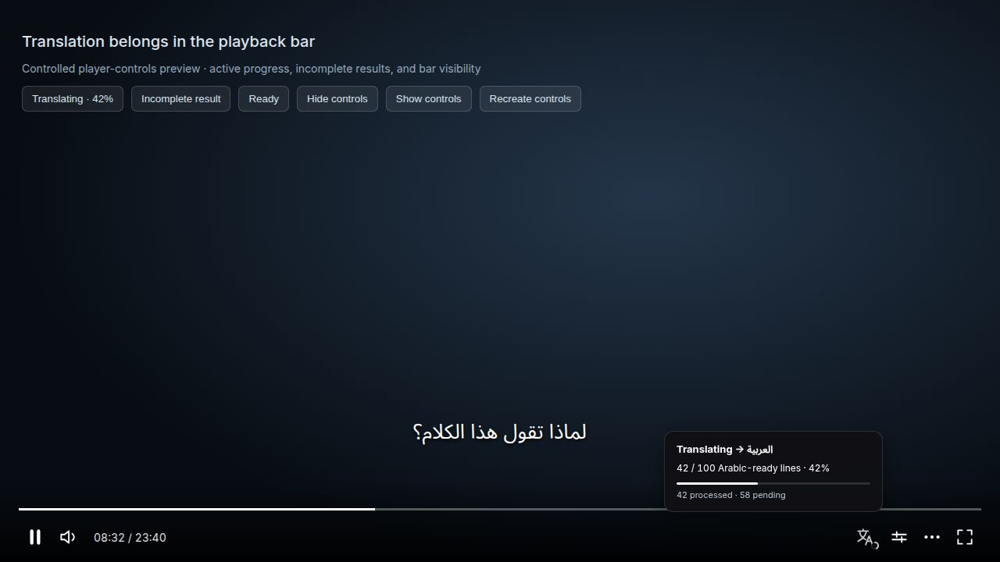
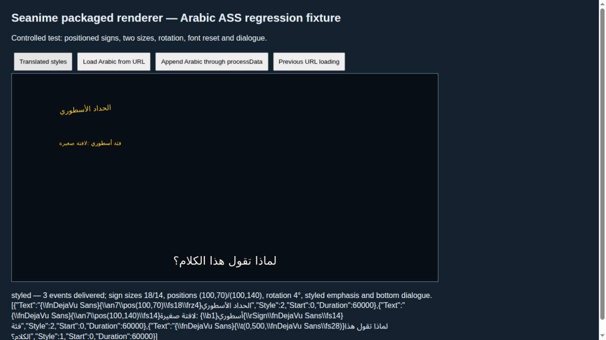
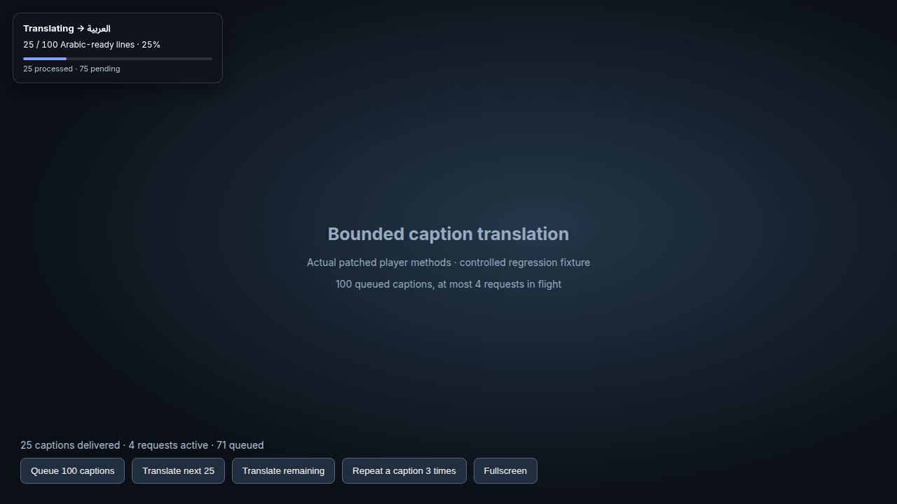
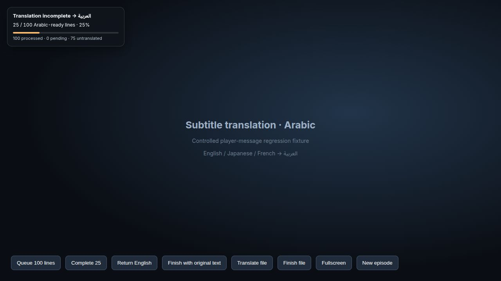

# Arabic subtitle repair and translation status

Unofficial Linux x86_64 Seanime 3.10.4 build, forked from [5rahim/seanime](https://github.com/5rahim/seanime). Developed with assistance from OpenAI Codex on 2026-10-26. Original attribution and licenses remain in place.

## Download and run

Download `Seanime-3.10.4-Arabic-Fixed-13.AppImage` and `SHA256SUMS` from [release 13](https://github.com/Elias966/seanime/releases/tag/v3.10.4-arabic-fix.13). Close any running Seanime instance, then:

```sh
sha256sum -c SHA256SUMS
chmod +x Seanime-3.10.4-Arabic-Fixed-13.AppImage
./Seanime-3.10.4-Arabic-Fixed-13.AppImage
```

Python 3 is required; no pip packages are needed. The build uses the existing Seanime profile. The launcher starts the bundled local helper on `127.0.0.1:11435`, or reuses a compatible already-running helper. Helper revision is checked so an older helper cannot silently override these fixes. If an old standalone service occupies this port, update it or stop it before opening the AppImage:

```sh
systemctl --user disable --now seanime-translation-helper.service
```

That command is only relevant when the previous standalone helper was installed. The AppImage can start its bundled helper itself.

## Translation settings

For local Ollama:

- Provider: OpenAI-compatible
- Base URL: `http://127.0.0.1:11435/v1`
- Model: `gemma4:e2b`
- Target language: Arabic

Ollama itself remains at `http://127.0.0.1:11434`. All model requests stay local; no cloud fallback or model weights are bundled. Keep Ollama running.

**Restart Seanime and reload the episode/subtitle track after upgrading**, because old untranslated results can remain in the player/backend caches. The user also reported that toggling translation mode away and back after changing models helped stale model selection.

## Release 13: choose alternative anime artwork

Click **Change cover** beside the back arrow on an anime page, or use the small cover button that appears when hovering/focusing a library/search card. Pick a poster from the gallery, a plain title-only cover, or restore the original. No local file upload is needed. The chosen image replaces that anime's cover variants and banner, including library cards and hover previews.

Alternative posters come from the exact anime's MyAnimeList picture gallery, matched using its MAL ID. Only gallery links are used; recommendations/news images are excluded. Jikan's pictures API is a fallback. Available alternatives vary by title. The original and title-only choices remain available when a gallery cannot be loaded.

Choices and pinned image bytes are saved under `${XDG_DATA_HOME:-~/.local/share}/seanime/cover-overrides`, independently of the ordinary artwork cache quota. Choices also have a local frontend snapshot so saved images resolve immediately after restarting offline. Initial gallery discovery requires a connection; cached options remain available offline. Helper revision: `arabic-covers-v7`. Existing standalone helpers need the matching `translation_helper.py`, `artwork_cache.py` and new `cover_store.py` files, or can be stopped so the AppImage starts its bundled helper.

Validation: all **82 tests passed** (58 JavaScript, 24 Python), including the compiled player, navigation and shared Image component. New tests cover gallery filtering/deduplication, persisted selections after clearing the general cache and restarting offline, escaped title-only artwork, original restoration, disk-write failures, local API/CORS and immediate offline frontend resolution. A live MAL gallery returned 11 images for the test title and a selected image was pinned successfully. The packaged frontend was also checked against the running local backend: selecting an alternative updated the detail cover/banner and both library cards; reopening showed the saved selection, and restoring the original restored the original URLs. The native AppImage was launched separately. All earlier fixes are retained.

## Release 12: stay on the page after starting a download

Starting a torrent download no longer navigates automatically to the Downloads page. This applies to the normal confirmation dialog, individual file selection and magnet-command downloads. Debrid downloads also stay on the current page. Successful downloads still close their dialogs/drawers and show the existing “Download started” notification. The Downloads and Debrid pages remain accessible through normal navigation.

Only the success-callback redirects were removed. Download requests, destinations, file selections and streaming navigation retain their existing behavior. The packaged callbacks were checked for dialog cleanup and absence of navigation without starting additional downloads. The complete existing regression suite passed. All earlier subtitle, artwork and search-return fixes are retained.

## Release 11: anime back arrow and search return state

Anime detail pages now include an accessible back-arrow button above the cover/header. It returns to the immediately preceding in-app page, including the original search visit; directly opened detail pages fall back to Search.

Each browser history entry keeps its selected search parameters and scroll position in session storage. Returning to a saved search restores its complete filter object before applying URL defaults, preventing stale URL genres from replacing the user's selection. Infinite search results remain cached for 24 hours of inactivity, with mount refetch disabled, so previously loaded pages survive watching an episode. Returning to a virtualized grid uses the clicked result card's viewport offset; the stable card is used even when navigation happened through its hover preview. Restoration retries as content mounts/resizes and stops on deliberate user input. This navigation service works independently of Denshi view-transition settings.

The packaged frontend was tested with an Action URL and Action + Comedy selected in the controls: 96 loaded cards remained after visiting an anime, both genres remained selected, and the chosen card returned to the same **180.125 px** viewport offset. The absolute document scroll coordinate changed as the virtualized grid remeasured; the visible result position remained identical. Six navigation regressions cover history/filter snapshots, delayed mounting, manual cancellation, direct-entry fallback, hover previews and compiled query options. All 73 local tests passed (55 JavaScript, 18 Python). The native AppImage 11 was launched; UI interaction validation used the packaged frontend in a local browser connected to the same backend.

Search results themselves are held in memory, not serialized into browser storage; reloading or restarting the app fetches them again. The service saves up to 80 recent history snapshots to session storage. Earlier subtitle and offline-artwork fixes are retained.

## Release 10: readable Arabic phrases and dialogue layout

Some anime tracks encode an opening as hundreds of individual Latin letters, syllables and repeated glow/shadow effects. Translating each fragment produces unrelated Arabic words positioned in tiny Latin character slots. The selected full English track in the reported episode contains this exact pattern, alongside its normal dialogue.

The queue now buffers animated fragments briefly and reconstructs timed phrases before translation. It recovers word boundaries from glyph spacing (including proportional and monospaced layouts), removes duplicate effect layers and uses complete word layers when glyph layers are unavailable. Short sentence continuations are joined to their subject before translation. Arabic phrases get a full-width text box; simultaneous phrases use separate rows. Where a complete English lyric accompanies animated romanization, its Arabic translation supplies the lyric instead of adding phonetic fragments. Normal dialogue and ordinary styled signs retain their styles and timing. Translation-off behavior still uses the original events.

Plain dialogue split by ASS hard line breaks is now sent as one sentence, retaining its subject and tense; Arabic wraps naturally. Multiple independently styled runs continue to preserve their overrides. Light Arabic dialogue opts into libass whole-line BiDi/shaping (`\fe-1`). All Arabic captions, including positioned lyrics and signs, use zero letter spacing so Arabic letters join; font resets reapply that layout. Explicit inline spacing is normalized too. Positioned signs retain their source layout. See the [libass encoding documentation](https://github.com/libass/libass/wiki/Libass%27-ASS-Extensions#encoding-1). The helper prompt also handles syllabified source words and requests preservation of subject/tense. Helper revision: `arabic-phrases-v6`.

Validation includes a fresh full-track Gemma4 E2B run, all 309 dialogue events checked for Arabic results, real packaged JASSUB/WASM rendering at dialogue/opening/overlapping-lyric/ending timestamps, and 67 passing tests (18 Python, 49 JavaScript), including the compiled manager. The automated Arabic check confirms script coverage, not semantic perfection. Visual samples check joining, direction and placement rather than claiming uninterrupted native playback. The original media, subtitle text and paths are kept private.

A dedicated GitHub Actions workflow now runs the source regression suite automatically on relevant changes. Checks needing an extracted official player/bootstrap are enabled during local release verification; they skip when those artifacts are absent in CI. The release packager also rejects unexpected original hashes and ambiguous patch matches.

Restart with AppImage 10 and reopen the episode; cached translations and previously loaded frontend code must be replaced.

## Release 9: translate the full dialogue track

Dual-audio files can put a forced English “S&S” (signs and songs) track before their full English dialogue track. The upstream preferred-language selector explicitly prioritizes forced tracks. Translating that partial track can finish successfully while most spoken dialogue has no captions to translate.

When automatic translation is enabled, automatic selection now excludes forced/signs/song-only tracks **only when a full track in the same language is available**. Explicit manual selection, disabled translation, language preferences, “none”, and label blacklists retain their behavior. A lone partial track remains available. Labels identifying full dialogue or SDH are retained even if they also mention signs.

The reported local dual-audio episode contains a forced S&S track and a default full English track, with 309 additional dialogue events in the latter. Executing the original compiled selector against those track flags selects S&S; executing the repaired selector selects the dialogue track. Four new regression tests cover this case, label-only partial tracks, partial-only languages, disabled translation, none and blacklists. All **56 tests** pass (18 Python, 38 JavaScript), including the extracted compiled adapter. This validates track selection and retained subtitle behavior; it is not a claim of uninterrupted native playback or model translation quality.

Reload the episode after upgrading to rerun automatic selection. For an already open episode, choose **Subtitles → Dialog - ENG** rather than **S&S**.

## Release 8: persistent artwork for local libraries

A local video library does not imply offline artwork. The upstream offline-sync handler returns without syncing when the account is simulated/local, even when automatic offline options are enabled. Auto-save also only tracks currently watched AniList entries rather than every local series. The affected profile used a local account and had no tracked offline items/assets.

This release adds persistent artwork independently of AniList offline sync:

- The shared Image component routes supported public cover/thumbnail URLs through the bundled loopback helper. On a disk hit, no DNS lookup or external request is made, including after restarting the helper or AppImage.
- While online, a bounded background task reads the local library and warms the series covers and episode artwork from each entry's metadata, including episodes not yet opened. It runs at startup, on a browser online event and every five minutes.
- The cache uses `$XDG_DATA_HOME/seanime/artwork-cache` (normally `~/.local/share/seanime/artwork-cache`). It survives AppImage upgrades and is pruned by age when it exceeds 512 MiB. Images are limited to 8 MiB each. Clearing that directory removes the offline images.
- Supported HTTPS hosts: AniList (`s4.anilist.co`, `s.anilist.co`), TheTVDB artwork, TMDB images, MyAnimeList CDN and YouTube thumbnails. Other URLs keep the existing loading behavior. Credentials are never forwarded to those hosts; non-image responses and redirects to unsupported hosts are rejected.
- Existing `{{LOCAL_ASSETS}}` paths are normalized by the shared image resolver. Failed placeholder states retry when connectivity returns or background warming completes.

The current local profile was warmed: **195 images across 6 series**, **9,834,448 bytes**, no failures. A fresh helper/cache reader then served **195/195 from disk with external fetching disabled and zero outbound attempts**. This tests artwork delivery after cache-reader restart without changing the computer's network. A controlled browser preview displayed a real saved cover and episode thumbnail and reloaded both from disk. [Aggregate results](validation-artwork-8.json); private URLs, paths and library titles are excluded.

Validation also executes the actual extracted shared Image component, confirming cache routing, placeholder behavior and online/cache-ready retries. Six Python cache tests cover persistence, duplicate concurrent requests, URL/redirect restrictions, invalid/oversized responses and quota eviction. The complete suite passes 52 tests (18 Python, 34 JavaScript). This is not an uninterrupted offline test of every app page or a replacement for missing offline metadata.

Artwork must be downloaded at least once while online. A brand-new image that has never been cached cannot be recovered without its source. Background warming requires the local API to be available and accessible; password-protected profiles that block the background API request still cache supported images as they are viewed through the shared component. The Go backend and account sync behavior are unchanged.

The helper now includes two Python files: `translation_helper.py` and `artwork_cache.py`. If maintaining an old standalone service manually, update both files or stop that service and let the AppImage start its bundled helper. No pip dependencies or model weights are needed. Image caching works even when Ollama is not running; model translation still requires it.

## Release 7: translation progress in the playback controls

Translation status is now an outline icon beside Settings in the actual playback control bar, matching the neighboring controls. A small ring shows progress; amber marks incomplete results and green marks received Arabic results. Hover, focus or click to see the percentage, pending work and untranslated results. Escape or an outside click dismisses the details.

The icon and details are children of the real bar rather than a fixed page overlay. They inherit its fade/slide behavior and fullscreen placement, including hiding when only the seek bar is shown. Desktop and mobile controls both have dedicated mounting slots; the mobile details open below the top control row. Details are clamped to the player/viewport width. Completed status remains available when the bar is shown until the next episode or translation is disabled.

The browser regression preview used the actual progress script and the player's control-bar attributes. Active 42%, incomplete 85%, ready 100%, Escape dismissal, hide/show and controls being recreated were checked. These are controlled UI checks, not a claim of new uninterrupted episode playback. The extracted AppImage's progress script and compiled player were verified against the source/patch recipe; the compiled player contains both desktop and mobile slots. All 42 existing translation/helper/renderer tests passed.



[Incomplete translation details](translation-toolbar-incomplete.png). Subtitle translation behavior and the release 6 fixes below remain included.

## Release 6: preserve signs and close font-repair gaps

The reported screenshots show missing glyphs, literal formatting fragments, and on-screen signs enlarged into default dialogue. Code inspection and controlled renderer tests reproduced relevant causes; the reporter's exact subtitle file was not supplied.

The prior event translator replaced the complete ASS `Text` field, throwing away inline size, position, color, rotation, line breaks and style resets. The backend whole-file translator also reconstructed text through an intermediate subtitle representation that discarded inline formatting. This release keeps ASS formatting outside the model entirely:

- Translate plain text runs, then rebuild each original event with its own override blocks and hard breaks. Repeated dialogue can still share a translation without sharing its visual styling.
- Drawing commands and coordinates stay unchanged. Drawing-only/formatting-only events need no model call.
- Libass file tracks use the same bounded plain-text queue, rebuilding the original ASS document with metadata, styles and event fields retained. A separate translated track is added when ready, leaving the source track intact.
- Multi-style file tracks bypass global subtitle customization and clear stale style overrides. Arabic uses the bundled DejaVu Sans family; original Latin-only font families cannot necessarily render Arabic. Sizes, positions and other supported ASS properties remain.
- Initial URL-loaded tracks and streamed `processData` events now receive the font repair. They previously bypassed it, reproducing square glyphs even with the bundled font installed.
- Font-command rewriting only touches ASS override blocks. Fonts inside transforms retain closing parentheses, and repeated repair is stable.
- Model responses containing broken braces/formatting commands, replacement characters or private-use glyphs trigger a local retry. Invalid text is not accepted as Arabic success or inserted as executable ASS.

The last local episode's full 362-event track retained every metadata line, event prefix, all 18 override blocks and all 75 hard breaks during queue reconstruction. It produces 437 translatable runs / 426 unique requests. This structural audit used deterministic replacements, not a claim of semantic translation quality. [Aggregate structural results](validation-ass-preservation-6.json).

The actual packaged JASSUB JavaScript and WebAssembly renderer was visually tested with styled signs and dialogue: direct content, initial URL loading and streamed `processData` all displayed Arabic without square glyphs. The previous worker reproduced squares on the same URL-loaded fixture. A four-line real `gemma4:e2b` check (English and Japanese) returned Arabic in 6.4 seconds. The automated suite has 12 helper tests and 30 JavaScript tests, including compiled player adapters and all worker ingress paths.

The final full-track run used the actual patched compiled manager, current queue, new local helper and real `gemma4:e2b`: **362/362 Arabic events**, **426 requests / 107 HTTP batches**, **121.25 seconds**, maximum **4 outstanding requests**, **zero request errors**, and **zero tag, hard-break or event metadata mismatches**. [Aggregate live results](validation-live-6.json). The harness used a stale progress classifier during the run; its 75 hard-break warnings were reclassified with the corrected script without replacing any model outputs. This was a delivery/formatting harness with a renderer callback, not uninterrupted video playback or independent review of every translation's meaning.

The precheck ASAR was also statically analyzed with REA, scoped to the compiled player, queue and worker (parent evidence `ev_2f4146f6925e181351f4546c76c17b3927866e5d52d6465ddbbd9d777916886d`). Its static graph is partial and does not prove execution. Those three assets are byte-identical in the final image; the last rebuild updated the progress classifier. Final extraction verifies the shipped assets against source.



[Previous URL path showing boxes](arabic-url-subtitles-before.png) · [Fixed streamed captions](arabic-stream-subtitles-fixed.png)

These checks do not establish that the external reporter's entire episode is fixed: screenshots cannot recover the original ASS, embedded fonts or already-corrupted text. Text already saved as literal squares cannot be reconstructed by choosing a font. Translation quality still depends on the model; translating separate styled runs can reduce linguistic context. This release does not redesign karaoke syllable timing or resize translated text to fit longer Arabic wording.

## Release 5: prevent skipped captions under full-episode load

The previous player could submit an episode's subtitle requests without a concurrency limit. With a single local model generation slot, later requests exhausted the helper's 50-second deadline while waiting. The last-session logs showed deadline failures, source-language fallbacks and disconnected callers.

The player also kept only one waiting event per source text. Repeated dialogue overwrote earlier waiters, so some caption occurrences could receive no translated event even when the translation request succeeded.

Release 5 fixes the actual player delivery path:

- At most **four unique subtitle requests** are in flight. Remaining work stays queued in the player, before server request deadlines begin.
- One result is delivered to **every occurrence** of repeated dialogue, preserving each caption's own time, duration and style. Successful duplicate text can reuse its result.
- After seeking, queued dialogue at/after the current position takes priority over stale earlier work.
- Lost replies retry once; destroying the manager cancels pending timers/work.
- Progress includes the unsent backlog, so four active requests do not hide the rest of the episode's pending captions.
- The helper retries temporary local HTTP/network failures. A failed stuttered line gets a retry with repeated short hyphen fragments normalized; original caption metadata and timing remain intact.

Implementation: [`subtitle-translation-queue.js`](../../seanime-web/public/subtitle-translation-queue.js) and the updated [`VideoCoreSubtitleManager`](../../seanime-web/src/app/(main)/_features/video-core/video-core-subtitles.ts). The packager patches the exact corresponding official compiled manager using a fail-closed [patch recipe](../../scripts/patch_subtitle_scheduler.py). Changed frontend assets receive new content-addressed filenames and the runtime chunk map/index are updated, preventing old cached URLs from selecting the pre-fix manager.



### Full-track regression

The complete English subtitle track from the user's last played local episode was tested, not a short sample. The private media path and dialogue text are excluded from published files.

The final harness runs the **actual patched compiled manager methods**, bounded queue, local helper and real `gemma4:e2b`, simulating Seanime's 100 ms batching. It delivered **362/362 caption events with Arabic text**, using **354 raw requests / 89 HTTP batches**, at most **4 outstanding requests**, **0 request errors**, in **98.18 seconds**. Every delivered event retained its original start time, duration and style. Repeated events were included individually. [Aggregate results](validation-release-5.json).

This verifies whole-track translation/delivery and script checks, not independent semantic review, uninterrupted video playback, or visual inspection of every caption. An initial bounded helper test found one stuttered source line; full manager testing additionally exposed a source-specific Ollama HTTP 500 on that line. The final retry path handled it and the full track passed.

A browser fixture using the actual patched manager methods also verified the complete backlog counter and 103 caption deliveries from 100 unique requests when a caption was repeated three more times. The unit suite passed **11 helper tests and 15 progress/queue tests**, including the actual compiled manager adapter.

Static artifact analysis was scoped to the compiled manager and progress script in release 4 (REA parent evidence `ev_621bbf36206da6ee8cd9a7424f0d178ca5e524bcdba4c88cacb887e51b4734e4`). Its graph is partial and does not prove execution; the runtime tests described above supply the delivery evidence.

## Release 4: avoid false completion and whole-batch fallback

Earlier status logic could report completion after all requests returned, even when some returned original dialogue. A file with a single Arabic line could also be treated as ready despite untranslated dialogue elsewhere. Release 4 changes that behavior:

- Checks individual returned subtitle lines, including lines inside whole ASS/SRT/VTT files.
- Recognizes untranslated Japanese, Cyrillic, Chinese and other scripts, single English words, and obvious mixed-language output.
- Shows **Translation incomplete** while untranslated, mixed-language, timed-out or unverified results remain. It does not use the old "Translation finished" message.
- Percentage measures **Arabic-ready results / known lines**, rather than merely counting replies. Punctuation/music-only lines are neutral and do not require Arabic text.
- Processing a queue fully does not turn untranslated lines into success. For example, 25 Arabic lines and 75 original lines show **25%**, even though 100 requests have been processed.

These are script checks and heuristics. They do **not** verify the meaning of a translation, catch every foreign word, or guarantee translation accuracy. "Arabic results received" describes returned Arabic-script content, not verified semantic correctness. Proper names may be flagged conservatively; local retries ask for Arabic transliteration.



The local helper also fixes failure handling:

- Gemma 4 receives **one subtitle line per prompt**, preserving item IDs. In a real mixed-language batch, the model returned unrelated Arabic for several items; the same source lines translated correctly individually.
- Normal requests disable reasoning for speed. A failed line gets one additional reasoning-enabled attempt.
- A persistently failing line retains its source text and is reported as incomplete. It does not discard translations that succeeded for other lines.
- No source text is logged. Logs record timings, repair counts and untranslated counts.

Persistently failing source lines can be cached by Seanime; restart/reload to retry them after resolving a model issue. This package does not modify the backend's caching or provider behavior.

## Progress indicator

An icon in the playback controls observes existing player WebSocket requests and results. It replaces the top-left overlay in release 7. It works for translation into Arabic from any source language and is independent of provider: Ollama, Google, etc.

For event tracks it shows Arabic-ready results, percentage, processed lines, pending lines, untranslated/mixed-language results and timeouts. The denominator includes observed requests and the bounded scheduler backlog, and can increase as more subtitle events arrive. Repeated source text can share one translation job while all caption occurrences receive its result. It is not an estimate of every line in the whole episode.

Libass ASS file tracks in release 6 use the bounded text queue and therefore report known text-run progress. For other whole subtitle files the existing backend provides no intermediate line counts. The overlay shows activity until the file returns, then inspects its dialogue. It does not invent an intermediate file percentage. Requests without a response after 75 seconds and files still pending after five minutes produce warnings; late responses can still update status.

The overlay supports DOM fullscreen, resets for a new episode, ignores mouse input, respects reduced-motion settings and has accessible status labels. The icon and its details hide with the playback controls; completed and incomplete states remain available from the bar until the next episode. Disabled translation and non-Arabic targets hide it.

Implementation: [`seanime-web/public/translation-progress.js`](../../seanime-web/public/translation-progress.js), loaded before the existing frontend scripts. It observes messages without rewriting them.

## Arabic font repair

The packaged JASSUB/libass WebAssembly renderer did not reliably select an Arabic-capable font. The default Roboto lacks Arabic, embedded fonts vary by episode, and some multi-style subtitle tracks bypass user font customization. Installing a Linux font alone did not solve the tested cases.

The repair bundles unmodified DejaVu Sans and its license, loads it in JASSUB before rendering, and applies explicit font selection to Arabic-containing events. It covers initial ASS content and URL loading, track replacements, live MKV event creation/updates, streamed ASS chunks, inline font changes and style resets. Timing, placement, colors and other ASS properties are retained; font selection changes only on Arabic-containing events. It cannot recover text already replaced with literal square characters or fix mistranslations.

[Original square-glyph fixture](subtitles-before.png) · [Repaired rendering](subtitles-repaired.png).

Implementation: [`seanime-web/public/jassub/jassub-worker.js`](../../seanime-web/public/jassub/jassub-worker.js). Updating/transpiling JASSUB can overwrite this direct vendor patch.

## Rebuild

The release repackages the official [3.10.4 Linux x86_64 AppImage](https://github.com/5rahim/seanime/releases/tag/v3.10.4), whose SHA256 is:

```text
bc1d3b5b045b1be1378f4501afc436bf282c052d5fb254513addf2e3af7014f5
```

The script preserves the original runtime, extracts SquashFS, rewrites Electron ASAR offsets/integrity metadata, and repacks with xz. Nine ASAR entries are added or changed from upstream: the worker, font, font license, content-addressed progress/queue/artwork scripts, patched player chunk, updated runtime bootstrap, and `index.html`. The index loads the new bootstrap, whose chunk map selects the patched player. It preserves the original `AppRun` as `AppRun.upstream`, installs a helper startup wrapper, and adds `resources/seanime-translation-helper.py` and `resources/artwork_cache.py`. The bootstrap also patches the shared Image component to use the artwork resolver and retry events. The Go backend, Electron and WebAssembly binaries are unchanged.

Check out the release tag, install Python 3 and `squashfs-tools`, then:

```sh
python3 scripts/repack-arabic-appimage.py \
  /path/to/seanime-denshi-3.10.4_Linux_x86_64.AppImage \
  ./Seanime-3.10.4-Arabic-Fixed-13.AppImage
```

The script verifies the official image and original worker hashes. Allow several GB of temporary disk space. Filesystem timestamps/tool versions can change the final compressed AppImage checksum; `SHA256SUMS` applies to the uploaded asset.

## Tests and limitations

```sh
python3 -m unittest discover -s scripts/arabic-translation -v
node --test scripts/arabic-translation/test-progress.cjs scripts/arabic-translation/test-subtitle-queue.cjs scripts/arabic-translation/test-ass-format.cjs scripts/arabic-translation/test-worker-font.cjs scripts/arabic-translation/test-offline-artwork.cjs
# SEANIME_BOOTSTRAP can select the extracted patched bootstrap to test the shared Image component.
# To test the compiled adapter too, set SEANIME_PLAYER_BUNDLE to the extracted patched 9195.*.js path.
```

Release 4 passed eight helper and eight progress tests. Regression cases include partial batch failure, a second-attempt recovery, Gemma per-line prompts, non-Latin text, mixed output, missing rows, file-level partial translation, duplicate dialogue, late responses, settings races and episode resets. Browser checks reproduced a fully processed queue with untranslated lines and verified the incomplete status/percentage.

An eight-line real local Gemma test containing English, Japanese, Russian, Chinese, French, Spanish and a proper name completed in 1.25 seconds, with Arabic results for every line. The tested Japanese, Russian and Chinese lines had unrelated meanings in a batched request; the individual prompts returned relevant translations. This is a small regression sample, not a guarantee of accuracy or continuous playback of every episode.

Earlier font tests used the actual packaged JavaScript/WASM renderer for Arabic, diacritics, Latin/Arabic mixtures, punctuation, multiple ASS styles and inline font overrides. Live event updates and representative samples from three episode ASS tracks were rendered in the repaired Electron runtime.

## Rollback and licenses

To remove the local translation helper from the request path, change the base URL back to `http://127.0.0.1:11434/v1`. Close this build and open the original official AppImage. Both use the existing profile. Future official updates may replace the repair; it is not integrated upstream.

Seanime retains its upstream GPL-3.0 license. DejaVu Sans retains its [included font license](../../seanime-web/public/fonts/DejaVuSans.LICENSE.txt). Other bundled dependencies retain their original notices.
